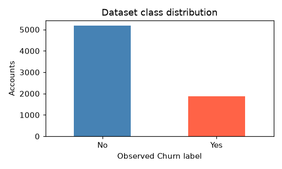
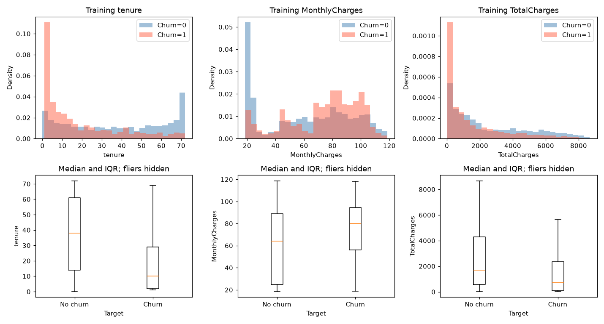
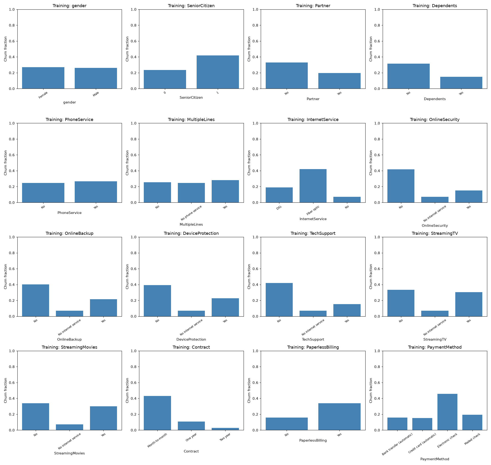
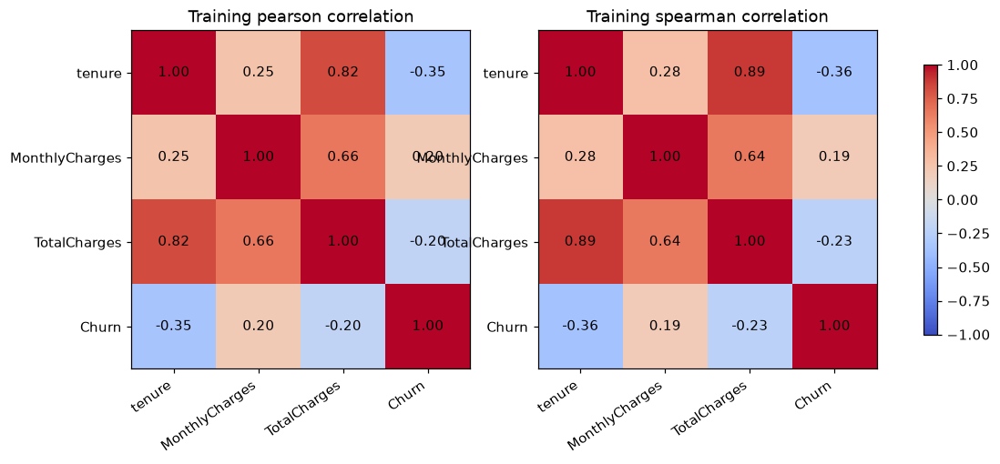

# EDA and data quality

Executed on the supplied CSV. Shape: 7043 rows × 21 columns.
Verified target: Churn; No=5174, Yes=1869 (26.54% positive).
Dataset SHA-256: `88be4b93fbe0cc83421af1c503794c97c342eca914c1576db7c276e61d61358a`.

Full-data inspection is limited to schema, quality, and overall class counts.
All target relationships, distributions, and correlations below use ONLY the training partition
(4929 rows), so held-out test behavior does not guide feature/model choices.

## Quality and handling

column | dtype | missing | blank | unique
--- | --- | --- | --- | ---
customerID | object | 0 | 0 | 7043
gender | object | 0 | 0 | 2
SeniorCitizen | int64 | 0 | 0 | 2
Partner | object | 0 | 0 | 2
Dependents | object | 0 | 0 | 2
tenure | int64 | 0 | 0 | 73
PhoneService | object | 0 | 0 | 2
MultipleLines | object | 0 | 0 | 3
InternetService | object | 0 | 0 | 3
OnlineSecurity | object | 0 | 0 | 3
OnlineBackup | object | 0 | 0 | 3
DeviceProtection | object | 0 | 0 | 3
TechSupport | object | 0 | 0 | 3
StreamingTV | object | 0 | 0 | 3
StreamingMovies | object | 0 | 0 | 3
Contract | object | 0 | 0 | 3
PaperlessBilling | object | 0 | 0 | 2
PaymentMethod | object | 0 | 0 | 4
MonthlyCharges | float64 | 0 | 0 | 1585
TotalCharges | object | 0 | 11 | 6531
Churn | object | 0 | 0 | 2

- Duplicate rows: 0; constant columns: [].
- High-cardinality columns: ['customerID', 'TotalCharges'].
  customerID excluded as identifier.
- TotalCharges has 11 blank strings;
  11 coincide with zero tenure. Parse blanks to missing,
  retain every row, and median-impute inside each training fold.
  Do not assume a missing bill is zero.
- Parsed numeric missing counts: {'tenure': 0, 'MonthlyCharges': 0, 'TotalCharges': 11}.
- Service category inconsistency count: 0.
- Negative/nonfinite numeric values, invalid categories, missing targets, duplicate IDs,
  schema changes, and constant predictors cause explicit validation errors.
- Training IQR outlier counts: {'tenure': 0, 'MonthlyCharges': 0, 'TotalCharges': 0}. Outliers are flags, not automatic deletion rules.

## Leakage and availability

Churn is the target and never enters the predictors. customerID is unique and has no justified
predictive role. No explicit post-outcome column was found. Contract, tenure, services, payment
method, and accumulated charges are provisionally available at the scoring snapshot; the CSV
does not establish their timing relative to churn. Validate as-of timestamps and the prediction
horizon with the data owner before production. These associations do not establish causation.
gender and SeniorCitizen may create fairness risks; retain for this exploratory comparison only,
with subgroup validation and governance required before deployment.

## Training-only relationships

Numeric summary:

feature | count | mean | std | min | 25% | 50% | 75% | max
--- | --- | --- | --- | --- | --- | --- | --- | ---
tenure | 4929.0000 | 32.4538 | 24.7147 | 0.0000 | 9.0000 | 29.0000 | 56.0000 | 72.0000
MonthlyCharges | 4929.0000 | 64.7268 | 30.2664 | 18.4000 | 35.0000 | 70.4000 | 90.0500 | 118.7500
TotalCharges | 4920.0000 | 2292.9366 | 2278.4460 | 18.8500 | 393.2500 | 1402.6750 | 3839.7125 | 8684.8000

Numeric correlation with churn (Pearson; binary target gives point-biserial association):

index | correlation
--- | ---
tenure | -0.3503
MonthlyCharges | 0.1975
TotalCharges | -0.1981

The plots compare normalized numeric distributions, so the majority class does not dominate
the histograms. Boxplots summarize distributions without publishing individual outlier points.
Churn fractions compare categories rather than raw counts; cells with fewer than 20 accounts
are suppressed. Pearson/Spearman correlations assess redundancy, not feature selection.
TotalCharges and tenure share accumulated-exposure information; correlated predictors can
divide permutation importance. Service flags also encode structural redundancy.
The minority churn class makes average precision a useful selection metric, with a random
ranking reference near the positive prevalence. Recall measures missed churners; precision
measures how many flagged accounts actually churn. F1 balances these at a fixed threshold;
ROC-AUC summarizes ranking across thresholds but can obscure operational precision.

### Contract

category | count | churn_rate
--- | --- | ---
Month-to-month | 2708.0000 | 0.4309
One year | 1022.0000 | 0.1067
Two year | 1199.0000 | 0.0267

On training data, Contract=Month-to-month has the highest observed churn fraction (43.1%, n=2708); Two year has the lowest (2.7%, n=1199). This is descriptive association, not an adjusted effect.

### InternetService

category | count | churn_rate
--- | --- | ---
DSL | 1701.0000 | 0.1899
Fiber optic | 2154.0000 | 0.4220
No | 1074.0000 | 0.0708

On training data, InternetService=Fiber optic has the highest observed churn fraction (42.2%, n=2154); No has the lowest (7.1%, n=1074). This is descriptive association, not an adjusted effect.

### PaymentMethod

category | count | churn_rate
--- | --- | ---
Bank transfer (automatic) | 1072.0000 | 0.1586
Credit card (automatic) | 1066.0000 | 0.1510
Electronic check | 1660.0000 | 0.4566
Mailed check | 1131.0000 | 0.1936

On training data, PaymentMethod=Electronic check has the highest observed churn fraction (45.7%, n=1660); Credit card (automatic) has the lowest (15.1%, n=1066). This is descriptive association, not an adjusted effect.

### OnlineSecurity

category | count | churn_rate
--- | --- | ---
No | 2446.0000 | 0.4170
No internet service | 1074.0000 | 0.0708
Yes | 1409.0000 | 0.1505

On training data, OnlineSecurity=No has the highest observed churn fraction (41.7%, n=2446); No internet service has the lowest (7.1%, n=1074). This is descriptive association, not an adjusted effect.

### TechSupport

category | count | churn_rate
--- | --- | ---
No | 2411.0000 | 0.4197
No internet service | 1074.0000 | 0.0708
Yes | 1444.0000 | 0.1524

On training data, TechSupport=No has the highest observed churn fraction (42.0%, n=2411); No internet service has the lowest (7.1%, n=1074). This is descriptive association, not an adjusted effect.

### Main numerical findings

Training mean tenure: churners 18.05, non-churners 37.66. Differences may provide predictive signal but also reflect exposure/confounding.

Training mean MonthlyCharges: churners 74.67, non-churners 61.13. Differences may provide predictive signal but also reflect exposure/confounding.

Training mean TotalCharges: churners 1542.98, non-churners 2564.51. Differences may provide predictive signal but also reflect exposure/confounding.

Use model/CV and validation permutation evidence in the model report to rank features.
