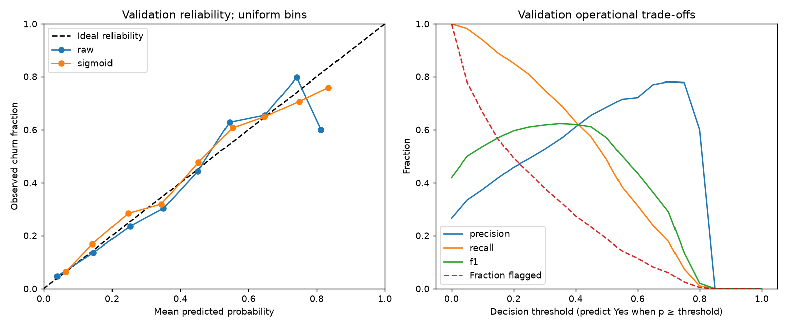

# Milestone 3: model validation, thresholds and MLflow

Parent run: `a644309446d34b7ca25ea160124aeba6`. Final selected run: `512d717fe25e46aea32ed10744c49541`.
Dataset fingerprint: `88be4b93fbe0cc83421af1c503794c97c342eca914c1576db7c276e61d61358a`.
Split sizes: {'train': 4929, 'validation': 1057, 'test': 1057}; seed 42. Baseline reports and
original artifacts remain unchanged. Historical executed notebooks are archived
under ignored notebooks/executed/history/baseline/.

## Model validation and selection boundary

Reuse four pipelines and the hyperparameters selected by prior training-only CV.
Rerun stratified training CV, with every imputer/encoder/scaler fitted inside folds.
Choose maximum mean CV average precision. Retain all 19 inputs: the previous
training-CV selector was rejected; no new feature search is performed. CV is not
nested; hyperparameters were chosen on these training folds historically.

model | precision | recall | f1 | roc_auc | average_precision
--- | --- | --- | --- | --- | ---
Dummy | 0.00000 ± 0.00000 | 0.00000 ± 0.00000 | 0.00000 ± 0.00000 | 0.50000 ± 0.00000 | 0.26537 ± 0.00044
LogisticRegression | 0.66054 ± 0.02512 | 0.56117 ± 0.02311 | 0.60630 ± 0.01672 | 0.84712 ± 0.00436 | 0.66459 ± 0.02326
RandomForest | 0.67199 ± 0.03229 | 0.50536 ± 0.01036 | 0.57676 ± 0.01843 | 0.84507 ± 0.00449 | 0.66527 ± 0.02531
HistGradientBoosting | 0.65341 ± 0.02736 | 0.52753 ± 0.01273 | 0.58339 ± 0.01278 | 0.84264 ± 0.00261 | 0.66254 ± 0.02107

The RF/LR near-tie does not prove forest superiority. No candidate test scores
are computed or logged. The test split was already evaluated in the historical
baseline; the new result is reuse of a holdout, not a new independent test.
Historical test results do not enter any executable decision rule.

## Validation-only calibration

Fit sigmoid CalibratedClassifierCV on training only with ensemble=False. Its OOF
probabilities come from clones of the COMPLETE preprocessing/model pipeline,
so no global fitted preprocessing enters calibration folds. Refit the base estimator
on training after fitting the sigmoid mapping. Compare to the raw model on validation;
select sigmoid only if its Brier score is strictly lower (ties retain raw).

probabilities | brier | log_loss | ece_uniform
--- | --- | --- | ---
raw | 0.1394 | 0.4313 | 0.0228
sigmoid | 0.1394 | 0.4343 | 0.0204

Brier and log loss are proper scores (lower is better); neither isolates calibration
from discrimination. ECE is descriptive, bin-dependent and noisy, not a confidence
bound or proof of reliable individual risk. Counts per reliability bin are in results.json.
No calibrator is fitted on validation or test. Validation is reused for calibration
choice and threshold scenarios, so validation-selected estimates may be optimistic.
No calibration metrics or reliability plots are computed on test.



## Threshold analysis and configurable cost scenario

All rows below use validation probabilities from the chosen calibration variant.
Threshold grid: 0–1 in steps of 0.05; prediction uses p ≥ threshold, including ties.
Zero flagged yields precision=0 by explicit zero-division convention.
Configured FN cost=1.0, FP cost=1.0.
These are illustrative relative units, NOT company costs or a proven business optimum.
Scenario cost = FN_cost × FN + FP_cost × FP; no retention capacity constraints,
intervention efficacy, or revenue effects are modeled.

threshold | precision | recall | f1 | tn | fp | fn | tp | flagged_percent | scenario_cost | cost_per_customer
--- | --- | --- | --- | --- | --- | --- | --- | --- | --- | ---
0.0000 | 0.2658 | 1.0000 | 0.4200 | 0.0000 | 776.0000 | 0.0000 | 281.0000 | 100.0000 | 776.0000 | 0.7342
0.0500 | 0.3345 | 0.9822 | 0.4991 | 227.0000 | 549.0000 | 5.0000 | 276.0000 | 78.0511 | 554.0000 | 0.5241
0.1000 | 0.3745 | 0.9395 | 0.5355 | 335.0000 | 441.0000 | 17.0000 | 264.0000 | 66.6982 | 458.0000 | 0.4333
0.1500 | 0.4181 | 0.8897 | 0.5688 | 428.0000 | 348.0000 | 31.0000 | 250.0000 | 56.5752 | 379.0000 | 0.3586
0.2000 | 0.4587 | 0.8505 | 0.5960 | 494.0000 | 282.0000 | 42.0000 | 239.0000 | 49.2904 | 324.0000 | 0.3065
0.2500 | 0.4903 | 0.8078 | 0.6102 | 540.0000 | 236.0000 | 54.0000 | 227.0000 | 43.8032 | 290.0000 | 0.2744
0.3000 | 0.5249 | 0.7509 | 0.6179 | 585.0000 | 191.0000 | 70.0000 | 211.0000 | 38.0322 | 261.0000 | 0.2469
0.3500 | 0.5632 | 0.6975 | 0.6232 | 624.0000 | 152.0000 | 85.0000 | 196.0000 | 32.9234 | 237.0000 | 0.2242
0.4000 | 0.6103 | 0.6299 | 0.6200 | 663.0000 | 113.0000 | 104.0000 | 177.0000 | 27.4361 | 217.0000 | 0.2053
0.4500 | 0.6545 | 0.5730 | 0.6110 | 691.0000 | 85.0000 | 120.0000 | 161.0000 | 23.2734 | 205.0000 | 0.1939
0.5000 | 0.6850 | 0.4875 | 0.5696 | 713.0000 | 63.0000 | 144.0000 | 137.0000 | 18.9215 | 207.0000 | 0.1958
0.5500 | 0.7152 | 0.3843 | 0.5000 | 733.0000 | 43.0000 | 173.0000 | 108.0000 | 14.2857 | 216.0000 | 0.2044
0.6000 | 0.7213 | 0.3132 | 0.4367 | 742.0000 | 34.0000 | 193.0000 | 88.0000 | 11.5421 | 227.0000 | 0.2148
0.6500 | 0.7701 | 0.2384 | 0.3641 | 756.0000 | 20.0000 | 214.0000 | 67.0000 | 8.2308 | 234.0000 | 0.2214
0.7000 | 0.7812 | 0.1779 | 0.2899 | 762.0000 | 14.0000 | 231.0000 | 50.0000 | 6.0549 | 245.0000 | 0.2318
0.7500 | 0.7778 | 0.0747 | 0.1364 | 770.0000 | 6.0000 | 260.0000 | 21.0000 | 2.5544 | 266.0000 | 0.2517
0.8000 | 0.6000 | 0.0107 | 0.0210 | 774.0000 | 2.0000 | 278.0000 | 3.0000 | 0.4730 | 280.0000 | 0.2649
0.8500 | 0.0000 | 0.0000 | 0.0000 | 776.0000 | 0.0000 | 281.0000 | 0.0000 | 0.0000 | 281.0000 | 0.2658
0.9000 | 0.0000 | 0.0000 | 0.0000 | 776.0000 | 0.0000 | 281.0000 | 0.0000 | 0.0000 | 281.0000 | 0.2658
0.9500 | 0.0000 | 0.0000 | 0.0000 | 776.0000 | 0.0000 | 281.0000 | 0.0000 | 0.0000 | 281.0000 | 0.2658
1.0000 | 0.0000 | 0.0000 | 0.0000 | 776.0000 | 0.0000 | 281.0000 | 0.0000 | 0.0000 | 281.0000 | 0.2658

Validation-grid scenario minimum: threshold **0.45**,
cost 205.00, flagged
23.27%. Ties favor fewer flagged customers,
then the higher threshold. This is an empirical grid estimate; it is not the
analytic Bayes cutoff and does not establish a business optimum.

Lowering thresholds generally catches more churners but increases false positives
and outreach volume. Higher thresholds save capacity at the cost of missed churners.
Precision is outreach yield; recall is captured churn; F1 balances these without costs.
Default policy remains fixed 0.5; CHURN_THRESHOLD_POLICY=scenario explicitly opts
into the configured validation-grid scenario threshold. CHURN_FN_COST and
CHURN_FP_COST configure its relative costs. No automatic production promotion.

## Frozen final selected model

Decision saved to MLflow BEFORE test access:

```json
{
  "model_type": "RandomForest",
  "calibration": "raw",
  "threshold": 0.5,
  "threshold_policy": "fixed",
  "fn_cost": 1.0,
  "fp_cost": 1.0,
  "calibration_rule": "minimum validation Brier; ties retain raw",
  "threshold_rule": "fixed 0.5 unless explicitly opting into validation-grid scenario",
  "model_rule": "maximum training CV AP; frozen prior CV hyperparameters"
}
```

Refit chosen estimator/calibrator on train+validation only, with calibration OOF
folds confined to that development set. Then predict test probabilities once.
Refitting can change probability scale; validation threshold transfer is an assumption,
not a guarantee. No test-based correction or comparison to other models is made.

Final test metrics (only this selected run):

precision | recall | f1 | roc_auc | average_precision
--- | --- | --- | --- | ---
0.6500 | 0.5107 | 0.5720 | 0.8490 | 0.6598

Confusion matrix, actual rows No/Yes and predicted columns No/Yes:
`[[700, 77], [137, 143]]`. Full classification report in results.json.

## Tracking and artifact identity

Candidate child runs record complete model parameters, CV means/std/fold metrics,
validation metrics/confusion matrices, seed and feature configuration. Parent records
dataset/code/split hashes and dependency versions. Final child logs the frozen decision,
validation calibration/threshold tables, selected-model test metrics and evaluation,
figures/report and full preprocessing/calibration/model bundle.
Immutable reference: `runs:/512d717fe25e46aea32ed10744c49541/model/pipeline.joblib`.
Artifact SHA-256: `a84fc4ae356e8c25f92b7c7033c69258e4213ce8e3f932e66aec05fc9a72caee`.
Download via MLflow by this run ID/path; retrieval fingerprint and prediction parity
were verified on validation examples only. Local model: `models/validation-512d717fe25e46aea32ed10744c49541/pipeline.joblib`.
The decision threshold is in metadata.json; apply it to predict_proba[:, 1] explicitly
because sklearn predict() generally uses its own 0.5 rule. Never resolve latest.

## Outstanding risks

No production acceptance thresholds or actual error costs have been approved.
Temporal validity, fairness, dependency locking, independent future validation,
threshold-transfer stability and deployment remain unresolved. No API, Docker,
production artifact promotion or registry dependency is introduced.
