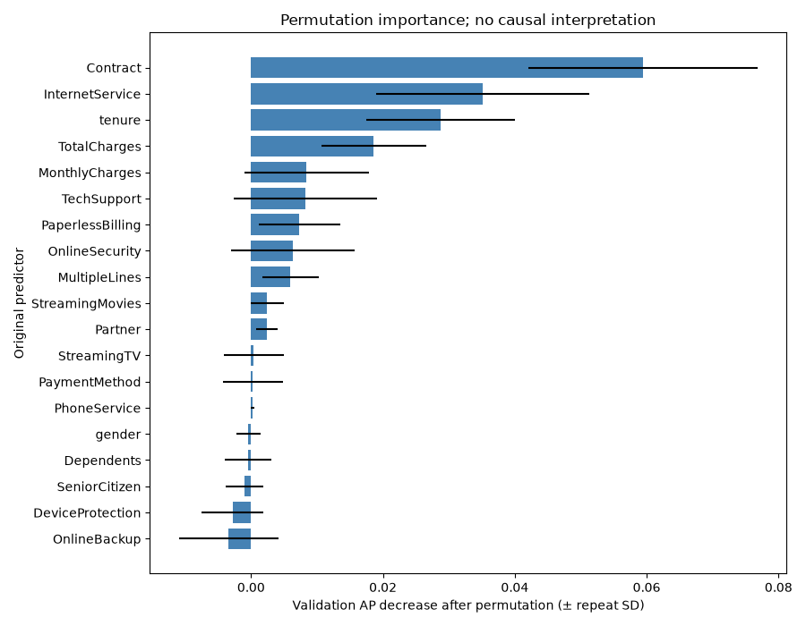
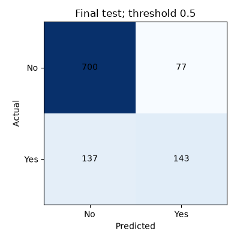

# Model comparison and selection

Executed experiment; seed=42; split sizes={'train': 4929, 'validation': 1057, 'test': 1057}.
Dataset SHA-256: `88be4b93fbe0cc83421af1c503794c97c342eca914c1576db7c276e61d61358a`. Code state: uncommitted.
Python 3.11.9; dependencies: {'scikit-learn': '1.9.1', 'pandas': '2.3.3', 'numpy': '2.4.6', 'joblib': '1.6.0'}.

## Protocol fixed before test evaluation

Four models use the same 5-fold shuffled stratified CV on the 70% training split.
All imputers, encoders, scaling and supervised selection are fitted inside folds. Numeric
medians and categorical modes impute missing values; unknown categories encode to all zeros.
Logistic Regression scales numeric inputs; tree models do not. Dense one-hot encoding is
feasible for this small dataset and keeps HistGradientBoosting compatible. No oversampling.
Class-weight None/balanced is compared for Logistic Regression and Random Forest; balanced
weights can improve recall at a cost to precision and probability calibration.
Select by maximum mean CV average precision; other metrics describe trade-offs.

model | precision | recall | f1 | roc_auc | average_precision
--- | --- | --- | --- | --- | ---
Dummy | 0.0000 ± 0.0000 | 0.0000 ± 0.0000 | 0.0000 ± 0.0000 | 0.5000 ± 0.0000 | 0.2654 ± 0.0004
LogisticRegression | 0.6605 ± 0.0251 | 0.5612 ± 0.0231 | 0.6063 ± 0.0167 | 0.8471 ± 0.0044 | 0.6646 ± 0.0233
RandomForest | 0.6720 ± 0.0323 | 0.5054 ± 0.0104 | 0.5768 ± 0.0184 | 0.8451 ± 0.0045 | 0.6653 ± 0.0253
HistGradientBoosting | 0.6534 ± 0.0274 | 0.5275 ± 0.0127 | 0.5834 ± 0.0128 | 0.8426 ± 0.0026 | 0.6625 ± 0.0211

Hyperparameters selected within training CV:

```json
{
  "Dummy": {},
  "LogisticRegression": {
    "model__C": 1.0,
    "model__class_weight": null
  },
  "RandomForest": {
    "model__class_weight": null,
    "model__max_depth": 8
  },
  "HistGradientBoosting": {
    "model__l2_regularization": 5.0,
    "model__max_leaf_nodes": 15
  }
}
```

Selected algorithm: **RandomForest** by highest mean CV average precision.
CV scores are selection estimates (optimistic after tuning), not a nested-CV performance claim.

## Feature selection and stability

customerID is excluded; Churn is separated before preprocessing. No constant columns were
found. All remaining 19 source predictors are available to preprocessing.
A second comparison fits L1 Logistic Regression SelectFromModel (C=0.1, threshold=mean)
after encoding INSIDE every fold. Retain selection only when its paired mean AP improvement
exceeds one paired standard error; otherwise prefer the full feature set. This is a heuristic
complexity rule, not a significance test. Foldwise model selection is not nested.
Selection used: **False**; AP difference=-0.08234;
paired SE=0.00634.
Selected encoded feature counts by fold: [14, 12, 13, 17, 15].
Selector CV metrics: {'precision': {'mean': 0.6145259027936502, 'std': 0.02964548935345973}, 'recall': {'mean': 0.4862566172384546, 'std': 0.018457024744302646}, 'f1': {'mean': 0.5427896964104937, 'std': 0.021765828931764212}, 'roc_auc': {'mean': 0.8196744612659425, 'std': 0.004124729753300238}, 'average_precision': {'mean': 0.5829297536544251, 'std': 0.026664423003821318}}.
Final fitted encoded features (46):
numeric__tenure, numeric__MonthlyCharges, numeric__TotalCharges, categorical__gender_Female, categorical__gender_Male, categorical__SeniorCitizen_0, categorical__SeniorCitizen_1, categorical__Partner_No, categorical__Partner_Yes, categorical__Dependents_No, categorical__Dependents_Yes, categorical__PhoneService_No, categorical__PhoneService_Yes, categorical__MultipleLines_No, categorical__MultipleLines_No phone service, categorical__MultipleLines_Yes, categorical__InternetService_DSL, categorical__InternetService_Fiber optic, categorical__InternetService_No, categorical__OnlineSecurity_No, categorical__OnlineSecurity_No internet service, categorical__OnlineSecurity_Yes, categorical__OnlineBackup_No, categorical__OnlineBackup_No internet service, categorical__OnlineBackup_Yes, categorical__DeviceProtection_No, categorical__DeviceProtection_No internet service, categorical__DeviceProtection_Yes, categorical__TechSupport_No, categorical__TechSupport_No internet service, categorical__TechSupport_Yes, categorical__StreamingTV_No, categorical__StreamingTV_No internet service, categorical__StreamingTV_Yes, categorical__StreamingMovies_No, categorical__StreamingMovies_No internet service, categorical__StreamingMovies_Yes, categorical__Contract_Month-to-month, categorical__Contract_One year, categorical__Contract_Two year, categorical__PaperlessBilling_No, categorical__PaperlessBilling_Yes, categorical__PaymentMethod_Bank transfer (automatic), categorical__PaymentMethod_Credit card (automatic), categorical__PaymentMethod_Electronic check, categorical__PaymentMethod_Mailed check.

Validation permutation importance permutes each raw column, grouping its encoded levels.
Ten repeats estimate perturbation variability (not confidence intervals). Stability is measured
by three-repeat permutation on each training CV validation fold. Top-5 frequency indicates
consistency across those five folds. It is conditional on the chosen hyperparameters, not an
independent feature-selection performance estimate. Negative/small importance can reflect
noise or redundancy; do not automatically discard it. Correlated features may substitute for
one another. Permutation importance gives magnitude, not direction or causation.

feature | ap_decrease | repeat_std | cv_mean_ap_decrease | cv_std_ap_decrease | cv_top5_frequency
--- | --- | --- | --- | --- | ---
Contract | 0.0595 | 0.0174 | 0.0731 | 0.0112 | 1.0000
InternetService | 0.0352 | 0.0162 | 0.0485 | 0.0058 | 1.0000
tenure | 0.0287 | 0.0113 | 0.0591 | 0.0057 | 1.0000
TotalCharges | 0.0186 | 0.0079 | 0.0220 | 0.0065 | 0.6000
MonthlyCharges | 0.0084 | 0.0095 | 0.0111 | 0.0067 | 0.2000
TechSupport | 0.0082 | 0.0109 | 0.0143 | 0.0060 | 0.4000
PaperlessBilling | 0.0074 | 0.0062 | 0.0140 | 0.0066 | 0.4000
OnlineSecurity | 0.0064 | 0.0094 | 0.0158 | 0.0084 | 0.4000
MultipleLines | 0.0060 | 0.0043 | 0.0079 | 0.0031 | 0.0000
StreamingMovies | 0.0025 | 0.0025 | 0.0005 | 0.0015 | 0.0000
Partner | 0.0024 | 0.0016 | -0.0021 | 0.0012 | 0.0000
StreamingTV | 0.0004 | 0.0045 | 0.0039 | 0.0033 | 0.0000
PaymentMethod | 0.0003 | 0.0045 | 0.0067 | 0.0059 | 0.0000
PhoneService | 0.0002 | 0.0003 | 0.0009 | 0.0014 | 0.0000
gender | -0.0004 | 0.0018 | -0.0003 | 0.0010 | 0.0000
Dependents | -0.0005 | 0.0035 | 0.0023 | 0.0050 | 0.0000
SeniorCitizen | -0.0010 | 0.0028 | 0.0036 | 0.0043 | 0.0000
DeviceProtection | -0.0028 | 0.0047 | 0.0000 | 0.0023 | 0.0000
OnlineBackup | -0.0034 | 0.0076 | 0.0018 | 0.0015 | 0.0000



## Frozen final evaluation

Threshold fixed at 0.5; it was not tuned on the test set. After selection and validation
explanations, refit the selected full pipeline on train+validation (85%). Predict held-out
test probabilities once and reuse those probabilities for every test metric/error summary.
Validation metrics below describe the earlier training-only fit, not the final 85% refit.

partition | precision | recall | f1 | roc_auc | average_precision
--- | --- | --- | --- | --- | ---
validation | 0.6850 | 0.4875 | 0.5696 | 0.8325 | 0.6313
test | 0.6500 | 0.5107 | 0.5720 | 0.8490 | 0.6598

Test confusion matrix: rows actual [No, Yes], columns predicted [No, Yes]:
`[[700, 77], [137, 143]]`.



Classification report:

label | precision | recall | f1-score | support
--- | --- | --- | --- | ---
No | 0.8363 | 0.9009 | 0.8674 | 777.0000
Yes | 0.6500 | 0.5107 | 0.5720 | 280.0000
macro avg | 0.7432 | 0.7058 | 0.7197 | 1057.0000
weighted avg | 0.7870 | 0.7975 | 0.7892 | 1057.0000

Aggregate test errors (groups below 20 suppressed; no raw records or identifiers):

```json
{
  "false_positive": {
    "count": 77,
    "numeric_means": {
      "tenure": 10.077922077922079,
      "MonthlyCharges": 78.8077922077922
    },
    "contract_counts": {
      "Month-to-month": 77
    }
  },
  "false_negative": {
    "count": 137,
    "numeric_means": {
      "tenure": 25.64963503649635,
      "MonthlyCharges": 69.91678832116789
    },
    "contract_counts": {
      "Month-to-month": 104,
      "One year": 28
    }
  }
}
```

False negatives miss potential churners; false positives spend retention resources on
non-churners. Lower thresholds generally increase recall and false positives. Choose a
cost-based threshold only on future training/validation data after business costs are agreed.
Class weights can distort calibration; no calibrated-risk claim is made. Test error summaries
are diagnostic only and do not trigger retuning in this run.

## Artifact and limits

Full parse/impute/encode/scale/optional-select/model bundle: `models/88be4b93fbe0-seed42-RandomForest-b8c487d8/pipeline.joblib` (Git ignored).
Artifact SHA-256: `a84fc4ae356e8c25f92b7c7033c69258e4213ce8e3f932e66aec05fc9a72caee`. Load trusted artifacts with `joblib.load`;
call `predict_proba` with the 19 input features listed in `model_results.json`. No manual
preprocessing is needed. No automatic artifact promotion, production gate, or API exists yet.
Dataset and source-code hashes, split hashes, seed, dependency versions, CV parameters and
metrics are recorded in model_results.json and the artifact's metadata.json. Exact dependency
locking remains outstanding; this is not a clean-environment reproducibility guarantee.

Historical snapshot data cannot establish temporal validity, fairness, causal effects, or
future performance. No external/temporal validation, subgroup fairness assessment, calibration,
deployment, or drift monitoring is implemented. Small CV differences should not be treated
as proof of superiority. Held-out test results must not drive another selection cycle.
MLflow integration remains Milestone 3; these structured outputs can be logged there.
